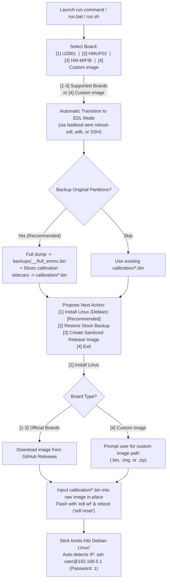

# OpenStick Installer

Cross-platform, minimal-action installation and flashing tool for the OpenStick community to turn Qualcomm Snapdragon 410 (MSM8916) Android USB dongles into Debian Linux devices using 1:1 raw eMMC images and Qualcomm Emergency Download (9008 EDL) mode.

---

## Supported Models

- **UZ801** (`UZ801` / `UZ801-V3`) — Qualcomm MSM8916 4G LTE USB Modem Dongle
- **HMUF02** (`HMUF02` / `HMUF02-V05` / `zbx002` / `UF05`) — Qualcomm MSM8916 4G LTE Wi-Fi USB Modem Dongle
- **HM-MIFIB** (`HM-MIFIB` / `MF800`) — Qualcomm MSM8916 4G LTE Mobile Wi-Fi Router with Battery & 128×128 LCD

### Device Identification: UZ801 vs. HMUF02-V05 (`zbx002`)

Many white 4G LTE USB dongles share identical casing, MSM8916 Snapdragon 410 SoC, 512 MB RAM, and 4 GB eMMC. When reading properties from stock Android over ADB (`adb shell getprop`):

| Property | UZ801 | HMUF02-V05 (`zbx002`) |
| --- | --- | --- |
| `ro.product.model` | `UZ801` | `UFI` |
| `ro.product.manufacturer` | `Qualcomm Technology` | `HiMI` |
| PCB Silkscreen | `UZ801_...` | `UF05 251208V05` / `zbx002` |
| Build Target | `msm8916_32_512-userdebug` | `msm8916_32_512-userdebug` |
| Target Profile | `uz801` | `hmuf02` |

> [!TIP]
> Notice that HMUF02 reports `ro.product.model = UFI`, **not** `HMUF02`. The reliable software differentiator is `ro.product.manufacturer = HiMI`. Stock firmware often has ADB enabled out of the box (no web toggle required).

---

## Features

- **Zero-Fuss Setup**: Automatically initializes a local Python virtual environment (`.venv`) and installs all required dependencies (`pyusb`, `pyserial`, `bkerler/edl`, etc.) with zero user intervention.
- **Double-Click Launchers**: Native one-click launchers for **Windows** (`run.bat`), **macOS** (`run.command`), and **Linux** (`run.sh`).
- **Automated EDL Transition**: Reboots sticks into Qualcomm 9008 EDL mode automatically via Fastboot (`fastboot oem reboot-edl`), ADB (`adb reboot edl`), or Linux SSH (`sudo systemctl reboot bootloader`), avoiding the need to dismantle casings, hold recovery buttons, or short EDL pins whenever possible.
- **Full eMMC Clone**: Dumps a complete 1:1 raw eMMC image (`full_emmc.bin`) into `backups/` for 100% brick-proof local recovery.
- **Dedicated `calibration/` Folder**: Automatically extracts your stick's unique cellular IMEI and radio calibration partitions (`modemst1`, `modemst2`, `fsg`, `fsc`, `persist`, `sec`) into the top-level `calibration/` directory. Also accepts user-provided partition dumps (`.bin` or `.img`).
- **Instant In-Place Calibration Injection (< 0.1s)**: Reads GPT offsets directly from the downloaded universal Linux image and writes your unique calibration data directly into the raw image on disk without slow multi-gigabyte file duplication.
- **Single-Step EDL Flashing**: Flashes the complete personalized system via `edl wf` and reboots the device with `edl reset`.
- **Automatic Network Discovery**: Automatically scans USB Ethernet and Wi-Fi to confirm Debian has booted and displays SSH login details.

---

## ⚠️ Disclaimer & Warning

Flashing Linux or custom firmware onto your device is an inherently risky process that writes directly to low-level eMMC partitions via Qualcomm Emergency Download (9008 EDL) mode. While this installer takes extensive precautions (such as backing up raw partitions and unique cellular calibration data), there is always a risk of hardware damage, lost cellular connectivity, or permanent bricking.

The script authors and contributors assume **no responsibility or liability** for any bricked devices, lost data, hardware damage, or other outcomes resulting from using this software. Proceed entirely at your own risk.

---

## Quick Start (Double-Click Execution)

### Option 1: Download Pre-Packaged ZIP (Recommended — No Git Needed)

1. Download [**openstick-installer.zip**](https://github.com/Basistiy/openstick-installer/releases/latest/download/openstick-installer.zip) from the [Latest Release](https://github.com/Basistiy/openstick-installer/releases/latest).
2. Extract the downloaded `.zip` folder.
3. Launch the installer for your operating system:
   - **Windows**: Double-click `run.bat`
   - **macOS**: Double-click `run.command`
   - **Linux**: Double-click `run.sh` (or `./run.sh` in terminal)

*Note: You do not need to manually create Python virtual environments or install pip packages; the installer bootstraps `.venv` and all dependencies on first launch.*

> [!NOTE]
> **Windows Users (EDL USB Driver)**: If Windows attaches a default serial COM port driver to the stick in Qualcomm 9008 EDL mode, Python's `libusb` will throw `NotImplementedError: Operation not supported`. To fix this, bind the generic **WinUSB** (or **libusb-win32**) driver with [Zadig](https://zadig.akeo.ie/):
> 1. Download and run **Zadig** as Administrator.
> 2. Go to **Options** -> check **List All Devices**.
> 3. Select **QUSB_BULK** or **Qualcomm HS-USB QDLoader 9008** (`VID: 05C6, PID: 9008`).
> 4. Choose **WinUSB** (or **libusb-win32**) and click **Replace Driver**.
> 5. Unplug and replug the stick, then re-run `run.bat`.

---

### Option 2: Clone via Git

```bash
git clone https://github.com/Basistiy/openstick-installer.git
cd openstick-installer
```

Launch the installer using `run.bat` (Windows), `run.command` (macOS), or `./run.sh` (Linux).

---

## Flashing Process



---

## Directory Structure

```text
openstick-installer/
├── run.command              # macOS double-clickable launcher
├── run.bat                  # Windows double-clickable launcher
├── run.sh                   # Linux launcher (auto-attaches terminal emulator)
├── main.py                  # CLI entry point
├── requirements.txt         # Dependencies
├── backups/                 # Full raw eMMC dumps (backups/<board>_<timestamp>_<imei>/full_emmc.bin)
├── calibration/             # Dedicated folder for unique device calibration files (*.bin or *.img)
│   └── README.md
├── loaders/                 # Qualcomm Firehose programmers (prog_emmc_firehose_8916.mbn)
├── openstick/               # Core engine
│   ├── adb.py               # ADB management and reboot helper
│   ├── bootstrap.py         # Automatic .venv creation & dependency manager
│   ├── devices.py           # Supported device definitions
│   ├── edl.py               # Qualcomm 9008 runner, GPT parser, sanitizer & flasher
│   ├── network.py           # Post-flash network & SSH discovery
│   ├── releases.py          # GitHub Releases downloader
│   └── ui.py                # User interface and prompts
└── tests/                   # Automated unit test suite (46 passing tests)
```

---

## Manual Calibration Files (`calibration/`)

If you previously dumped your partitions using QFIL, Qualcomm EDL (`edl r`), or Android `dd`, simply drop your files into the `calibration/` folder before flashing:

- `modemst1.bin` (or `modemst1.img`)
- `modemst2.bin` (or `modemst2.img`)
- `fsg.bin` (or `fsg.img`)
- `fsc.bin` (or `fsc.img`)
- `persist.bin` (or `persist.img`)
- `sec.bin` (or `sec.img`)
- `modem.bin` (or `modem.img`, optional)

---

## Connecting to Your Linux Stick

Once the flashing process finishes and the device reboots:

1. **USB Network Adapter (CDC-ECM / RNDIS)**:
   - Stick IP: `192.168.5.1` (or `192.168.68.1`)
   - SSH Command: `ssh user@192.168.5.1`
   - Default Password: `1`
   - Root Privileges: `sudo su` (passwordless)
2. **Wi-Fi Access Point (Fallback)**:
   - SSID: `Openstick`
   - Password: `openstick`
   - Stick IP: `192.168.4.1`
   - SSH Command: `ssh user@192.168.4.1`
3. **HM-MIFIB (`MF800`) Built-In Hardware & LCD Tools**:
   - `battery`: Show battery capacity %, voltage, and USB/battery power status.
   - `lcd-show <status|glosos|wave|on|off>` (or `lcd_ctl`): Control the 128×128 ST7735S color LCD and backlight (short-pressing the physical power button also toggles the screen).
   - `lte`: Query SIM card state, operator, signal strength, and LTE IP.
   - `usb-mode <status|gadget|host>`: Switch USB port between gadget (network) and host mode.

---

## Troubleshooting

### Windows: `NotImplementedError: Operation not supported or unimplemented on this platform`
This happens when `edl.py` attempts to connect via PyUSB / `libusb`, but Windows has assigned the default serial driver (`Qualcomm HS-USB QDLoader 9008` / `qcser`) instead of a generic USB driver.

**Fix:**
1. Download [Zadig](https://zadig.akeo.ie/).
2. Run `zadig.exe` as Administrator.
3. Click **Options** -> **List All Devices**.
4. Select `QUSB_BULK` or `Qualcomm HS-USB QDLoader 9008` (`VID: 05C6, PID: 9008`).
5. Select **WinUSB** (or **libusb-win32**) in the target driver field and click **Replace Driver**.
6. Reconnect the stick and re-run `run.bat`.

### Windows: Fastboot `05C6:9091` Missing Driver
When using `adb reboot edl`, some sticks reboot into Fastboot bootloader mode (`05c6:9091`). If Windows does not have an Android bootloader driver installed, `fastboot devices` will remain empty.
- **Fix**: The simplest and most reliable method is hardware EDL: unplug the stick, hold down the physical recovery/reset button, and plug it into USB. This enters Qualcomm 9008 mode directly and bypasses all Fastboot driver issues.

### Windows: Qualcomm Sahara `Mode detected: error`
If an EDL operation is interrupted or immediately after a full dump completes, the device remains executing the Firehose loader in RAM and will not respond to a new Sahara handshake.
- **Fix**: Unplug the stick from USB, hold down the reset button, and plug it back in to reboot into a fresh 9008 state.

---

## HMUF02-V05 (`zbx002`) Hardware Quirks & Debian Post-Install

1. **No RTC Clock Skew (`apt` signature verification failure)**:
   The dongle has no real-time clock (RTC) battery, causing its clock to initialize in 1970 or weeks in the past. On first boot, `apt-get update` may fail with:
   ```text
   Sub-process /usr/bin/sqv returned an error code (1) ... Verifying signature: Not live until ...
   ```
   **Fix**: Set the current UTC date and time manually or connect to Wi-Fi/NTP:
   ```bash
   sudo date -u -s "2026-11-18 12:00:00"
   sudo apt-get update
   ```

2. **Safe Shutdown: Use `halt`, not `poweroff`**:
   Because the stick is bus-powered, running `systemctl poweroff` instructs the PMIC to cut power, but continuous USB 5V VBUS causes the SoC to reboot ~15 seconds later. If you unplug the stick after `poweroff`, you risk pulling the stick while Debian is booting with a read-write filesystem.
   - **Always run `sudo systemctl halt`** to cleanly unmount filesystems and halt the SoC before unplugging.

3. **LED Sysfs Inversion & State Service**:
   - Physical LEDs are connected to GPIO 71 (Green), GPIO 72 (Red), GPIO 73 (Blue). Shipped `/usr/local/bin/led-test` verifies this routing.
   - In the device tree, labels are semantically inverted: `green:wlan` actually maps to the mobile cellular network (WAN), and `blue:wan` maps to WiFi (WLAN).
   - Shipped Debian images do not auto-drive LEDs by default. You can deploy a systemd service that monitors NetworkManager device states to drive steady red for power, blue for WiFi AP, and green for 4G LTE.

---

## Custom Image Support

If you have another MSM8916 board or want to flash a custom Linux image:
1. Select **`[4] Custom image`** in the main menu (or run with `--custom-image <path>` or `--board custom`).
2. The installer will prompt you to create a stock partition backup (`backups/custom_<ts>_<imei>/full_emmc.bin`) and extract unique calibration partitions (`calibration/`).
3. When choosing **Install Linux**, the installer will ask for the path to your raw eMMC image (`.bin`, `.img`) or firmware archive (`.zip`).
4. Your unique cellular calibration partitions will be injected in-place and flashed via Qualcomm 9008 EDL mode.

---

## Maintainer Tools

### Sanitize Raw Image (`--sanitize-image`)

To prepare a universal image for distribution on GitHub Releases, dump a working stick (`edl rf full_emmc.bin`) and run:

```bash
python3 main.py --sanitize-image backups/uz801_dump/full_emmc.bin
```

This zeroes out `modemst1`, `modemst2`, `fsg`, `fsc`, `persist`, `sec`, `misc`, and `ssd` in-place, making the image safe to compress and share publicly without leaking personal IMEI or security keys.
