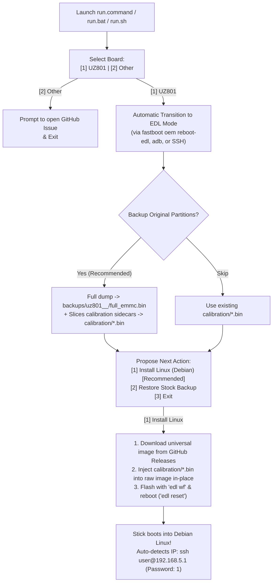

# OpenStick Installer

Cross-platform, minimal-action installation and flashing tool for the OpenStick community to turn Qualcomm Snapdragon 410 (MSM8916) Android USB dongles into Debian Linux devices using 1:1 raw eMMC images and Qualcomm Emergency Download (9008 EDL) mode.

---

## Features

- **Zero-Fuss Setup**: Automatically initializes a local Python virtual environment (`.venv`) and installs all required dependencies (`pyusb`, `pyserial`, `bkerler/edl`, etc.) with zero user intervention.
- **Double-Click Launchers**: Native one-click launchers for **Windows** (`run.bat`), **macOS** (`run.command`), and **Linux** (`run.sh`).
- **Automated EDL Transition**: Reboots sticks into Qualcomm 9008 EDL mode automatically via Fastboot (`fastboot oem reboot-edl`), ADB (`adb reboot edl`), or Linux SSH (`sudo systemctl reboot bootloader`), avoiding the need to dismantle casings, hold recovery buttons, or short EDL pins whenever possible.
- **Full eMMC Clone**: Dumps a complete 1:1 raw eMMC image (`full_emmc.bin`) into `backups/` for 100% brick-proof local recovery.
- **Dedicated `calibration/` Folder**: Automatically extracts your stick's unique cellular IMEI and radio calibration partitions (`modemst1`, `modemst2`, `fsg`, `fsc`, `persist`, `sec`) into the top-level `calibration/` directory. Also accepts user-provided partition dumps (`.bin` or `.img`).
- **Instant In-Place Calibration Injection (< 0.1s)**: Reads GPT offsets directly from the downloaded universal Linux image and writes your unique calibration data directly into the raw image on disk without slow multi-gigabyte file duplication.
- **Single-Step EDL Flashing**: Flashes the complete personalized system via `edl wf` and reboots the device with `edl reset`.
- **Automatic Network Discovery**: Automatically scans USB Ethernet and Wi-Fi to confirm Debian has booted and displays SSH login details.

---

## ⚠️ Disclaimer & Warning

Flashing Linux or custom firmware onto your device is an inherently risky process that writes directly to low-level eMMC partitions via Qualcomm Emergency Download (9008 EDL) mode. While this installer takes extensive precautions (such as backing up raw partitions and unique cellular calibration data), there is always a risk of hardware damage, lost cellular connectivity, or permanent bricking.

The script authors and contributors assume **no responsibility or liability** for any bricked devices, lost data, hardware damage, or other outcomes resulting from using this software. Proceed entirely at your own risk.

---

## Quick Start (Double-Click Execution)

Clone the repository to your computer:

```bash
git clone https://github.com/Basistiy/openstick-installer.git
cd openstick-installer
```

### 1. Launch the Installer

- **Windows**: Double-click `run.bat`
- **macOS**: Double-click `run.command`
- **Linux**: Double-click `run.sh` (or execute `./run.sh` in terminal)

*Note: You do not need to manually configure Python virtual environments or install pip packages; the script sets up everything on its first run.*

---

## Flashing Process



---

## Directory Structure

```text
openstick-installer/
├── run.command              # macOS double-clickable launcher
├── run.bat                  # Windows double-clickable launcher
├── run.sh                   # Linux launcher (auto-attaches terminal emulator)
├── main.py                  # CLI entry point
├── requirements.txt         # Dependencies
├── backups/                 # Full raw eMMC dumps (backups/uz801_<timestamp>_<imei>/full_emmc.bin)
├── calibration/             # Dedicated folder for unique device calibration files (*.bin or *.img)
│   └── README.md
├── loaders/                 # Qualcomm Firehose programmers (prog_emmc_firehose_8916.mbn)
├── openstick/               # Core engine
│   ├── adb.py               # ADB management and reboot helper
│   ├── bootstrap.py         # Automatic .venv creation & dependency manager
│   ├── devices.py           # Supported device definitions
│   ├── edl.py               # Qualcomm 9008 runner, GPT parser, sanitizer & flasher
│   ├── network.py           # Post-flash network & SSH discovery
│   ├── releases.py          # GitHub Releases downloader
│   └── ui.py                # User interface and prompts
└── tests/                   # Automated unit test suite (46 passing tests)
```

---

## Manual Calibration Files (`calibration/`)

If you previously dumped your partitions using QFIL, Qualcomm EDL (`edl r`), or Android `dd`, simply drop your files into the `calibration/` folder before flashing:

- `modemst1.bin` (or `modemst1.img`)
- `modemst2.bin` (or `modemst2.img`)
- `fsg.bin` (or `fsg.img`)
- `fsc.bin` (or `fsc.img`)
- `persist.bin` (or `persist.img`)
- `sec.bin` (or `sec.img`)
- `modem.bin` (or `modem.img`, optional)

---

## Connecting to Your Linux Stick

Once the flashing process finishes and the device reboots:

1. **USB Network Adapter (CDC-ECM / RNDIS)**:
   - Stick IP: `192.168.5.1` (or `192.168.68.1`)
   - SSH Command: `ssh user@192.168.5.1`
   - Default Password: `1`
   - Root Privileges: `sudo su` (passwordless)
2. **Wi-Fi Access Point (Fallback)**:
   - SSID: `Openstick`
   - Password: `openstick`
   - Stick IP: `192.168.4.1`
   - SSH Command: `ssh user@192.168.4.1`

---

## Maintainer Tools

### Sanitize Raw Image (`--sanitize-image`)

To prepare a universal image for distribution on GitHub Releases, dump a working stick (`edl rf full_emmc.bin`) and run:

```bash
python3 main.py --sanitize-image backups/uz801_dump/full_emmc.bin
```

This zeroes out `modemst1`, `modemst2`, `fsg`, `fsc`, `persist`, `sec`, `misc`, and `ssd` in-place, making the image safe to compress and share publicly without leaking personal IMEI or security keys.
