# OpenStick Installer — Universal Raw eMMC Image & EDL Flashing Plan

## 1. Goal & Architecture Overview

O`penstick-installer` - **Windows-style 1:1 raw eMMC image** workflow (`full_emmc.bin`) powered entirely by **Qualcomm 9008 EDL mode** (`edl rf` / `edl wf`), while keeping **ADB strictly as an optional convenience helper** (`adb reboot edl`) to enter EDL mode without pressing physical board buttons.

### Core Principles
1. **ADB Only for Entry, EDL for Everything Else**:
   - **ADB**: Used *only* when the stick is currently running Stock Android to trigger `adb reboot edl` via software. Never required after flashing (no post-boot `make_ext4fs` needed).
   - **EDL (`9008`)**: Performs 100% of backups (`edl rf` / `edl r`), partition table management, and full image restores (`edl wf`), working identically whether the stick has Stock Android, Debian Linux, or is soft-bricked.
2. **Sanitized Universal Raw Images (`full_emmc.bin`)**:
   - Maintainer dumps a working stick (`edl rf full_emmc.bin`, `3.64 GB` uncompressed) and runs `--sanitize-image` to zero out unique device partitions (`modemst1`, `modemst2`, `fsg`, `fsc`, `persist`, `sec`, `misc`, `ssd`) and clean empty `userdata`/`cache` space.
   - Because ~70%+ of the 3.64 GB image is `0x00` bytes, the universal image compresses to **`~232 MB` (Stock)** or **`~135–160 MB` (Debian)** inside a `.zip` file on GitHub Releases.
3. **In-Place User Calibration Injection (`< 0.1s`)**:
   - Every raw `full_emmc.bin` starts with the standard **GPT Partition Table** at byte offset `512` (sectors `1..33`).
   - Before flashing a downloaded universal `full_emmc.bin`, the installer parses the image's GPT header, seeks (`f.seek(start_sector * 512)`) in `"r+b"` mode to the exact byte offsets of `fsc`, `fsg`, `modemst1`, `modemst2`, `persist`, `sec` (and `modem` if needed), and writes the user's backed-up calibration files directly into `full_emmc.bin` on disk without copying the 3.64 GB file.
   - Finally, `edl wf full_emmc.bin --memory=eMMC` + `edl reset` flashes the entire personalized image in one step.

---

## 2. End-to-End Workflow Diagram

```mermaid
flowchart TD
    subgraph Maintainer["A. Maintainer Workflow (Preparing GitHub Release)"]
        M1["Configure stick (Stock Android or Debian)"] --> M2["Dump full eMMC in EDL:\nedl rf full_emmc.bin --memory=eMMC"]
        M2 --> M3["Sanitize image in-place:\npython3 main.py --sanitize-image full_emmc.bin"]
        M3 --> M4["Zeroes out modemst1, modemst2, fsg, fsc, persist, sec\n+ formats clean ext4 userdata/cache"]
        M4 --> M5["Compress to .zip (~140-232 MB)\n& upload to GitHub Releases"]
    end

    subgraph UserBackup["B. User Backup Workflow (Step 2)"]
        U0["Enter EDL Mode\n(via 'adb reboot edl' or physical button)"] --> U1{"Backup Type?"}
        U1 -->|"Full Clone (edl rf)"| U2["Save backups/<dev>_<ts>/full_emmc.bin (3.64 GB)\n+ auto-slice 7 calibration .bin sidecars (<0.1s)"]
        U1 -->|"Fast Calibration Backup (edl r)"| U3["Save 7 calibration .bin files (~99 MB, ~15s):\nfsc, fsg, modem, modemst1, modemst2, persist, sec"]
    end

    subgraph UserFlash["C. User Restore / Install Workflow (Step 3)"]
        F1{"Source Image?"}
        F1 -->|"User's Own Local full_emmc.bin"| F2["Already contains user's IMEI/calibration"]
        F1 -->|"Universal Image from GitHub"| F3["Download & extract universal full_emmc.bin"]
        F3 --> F4["In-Place Injection (<0.1s):\nParse GPT at offset 512, seek() & write\nuser's calibration .bin files into full_emmc.bin"]
        F2 --> F5["Flash in EDL Mode:\nedl wf full_emmc.bin --memory=eMMC"]
        F4 --> F5
        F5 --> F6["Reboot stick:\nedl reset"]
    end
```



---

## 3. GPT Partition Offset Reference (Stock vs. Debian)

Because the injector dynamically reads the GPT header at byte offset `512..17408` of the target `full_emmc.bin`, the **same injection function** works automatically for both Stock Android and Debian universal images despite their different partition layouts:

| Partition | Stock GPT `start_sector` (Byte Offset) | Debian GPT `start_sector` (Byte Offset) | Size | Shared in Universal Image? |
| :--- | :--- | :--- | :--- | :--- |
| `fsc` | `284,672` (`0x08B00000`) | `4,096` (`0x00200000`) | `1 KB` | **No** (Zeroed -> Injected from user backup) |
| `fsg` | `393,280` (`0x0C008000`) | `4,098` (`0x00200800`) | `1.5 MB` | **No** (Zeroed -> Injected from user backup) |
| `modem` | `131,072` (`0x04000000`) | `7,170` (`0x00380400`) | `64 MB` | **Yes** (or overridden from user backup if present) |
| `modemst1` | `276,480` (`0x08700000`) | `138,242` (`0x04380400`) | `1.5 MB` | **No** (Zeroed -> Injected from user backup) |
| `modemst2` | `279,552` (`0x08880000`) | `141,314` (`0x04500400`) | `1.5 MB` | **No** (Zeroed -> Injected from user backup) |
| `persist` | `2,067,552` (`0x3F18C000`) | `144,386` (`0x04680400`) | `32 MB` | **No** (Zeroed -> Injected from user backup) |
| `sec` | `396,352` (`0x0C188000`) | `209,922` (`0x06680400`) | `16 KB` | **No** (Zeroed -> Injected from user backup) |

---

## 4. Detailed Implementation Plan by File

### 4.1. `openstick/edl.py` — Raw Image GPT Parsing, Sanitization, Injection & Flashing

1. **`parse_gpt_from_raw_image(image_path: Path) -> Dict[str, Dict]`**
   - Read the first 34 sectors (`17,408` bytes) of `image_path`.
   - Verify the GPT signature (`b"EFI PART"`) at byte offset `512` (LBA 1).
   - Parse the GPT header fields (`current_lba`, `backup_lba`, `first_usable_lba`, `last_usable_lba`, `part_entry_start_lba`, `num_part_entries`, `part_entry_size`).
   - Parse each 128-byte partition entry (`starting_lba`, `ending_lba`, UTF-16LE `partition_name`) and return a dictionary mapping `label -> {start_sector, end_sector, num_sectors, byte_offset, byte_size}` plus metadata `{total_sectors: backup_lba + 1, total_bytes: (backup_lba + 1) * 512}`.

2. **`sanitize_raw_image(image_path: Path, wipe_partitions: Optional[List[str]] = None) -> Tuple[bool, List[Dict]]`**
   - Default `wipe_partitions`: `["fsc", "fsg", "modemst1", "modemst2", "persist", "sec", "misc", "ssd"]`.
   - Parse GPT from `image_path` via `parse_gpt_from_raw_image()`.
   - Open `image_path` in `"r+b"` mode.
   - For each partition present in the GPT:
     - `f.seek(part["byte_offset"])`
     - Write `0x00` bytes in `1 MB` chunks across the exact `part["byte_size"]` range.
   - Return `(True, summary_list)` detailing every wiped partition, its sector range, and byte size.

3. **`extract_partitions_from_raw_image(image_path: Path, output_dir: Path, partitions: Optional[List[str]] = None) -> bool`**
   - Default `partitions`: `["fsc", "fsg", "modem", "modemst1", "modemst2", "persist", "sec"]`.
   - Parse GPT from `image_path`.
   - Open `image_path` in `"rb"` mode, seek to each partition's `byte_offset`, read `byte_size` bytes, and write `<output_dir>/<part>.bin`.
   - Ensures any full eMMC dump immediately produces standalone `.bin` sidecars for the 7 critical partitions in `< 100 ms`.

4. **`inject_partitions_into_raw_image(image_path: Path, backup_dir: Path, partitions: Optional[List[str]] = None, dry_run: bool = False) -> Tuple[bool, List[str]]`**
   - Default `partitions`: `["fsc", "fsg", "modemst1", "modemst2", "persist", "sec"]` (plus `"modem"` if `modem.bin` exists in `backup_dir` and the target is Debian).
   - If `backup_dir` only contains a `full_emmc.bin` and hasn't had its sidecars extracted yet, call `extract_partitions_from_raw_image()` first.
   - Parse the target `image_path`'s GPT to locate the destination `byte_offset` and `byte_size` for each partition.
   - Open `image_path` in `"r+b"` mode:
     - Read `<backup_dir>/<part>.bin`.
     - Validate `len(part_bytes) <= target_part["byte_size"]`.
     - `f.seek(target_part["byte_offset"])` and write `part_bytes` (padding any remaining bytes in the partition slot with `b"\x00"`).
   - Return `(True, injected_partition_names)`.

5. **`execute_raw_emmc_backup(backup_dir: Path, loader: Optional[Path] = None, dry_run: bool = False) -> bool`**
   - Create `backup_dir`.
   - Run `edl rf <backup_dir>/full_emmc.bin --memory=eMMC [--loader=<loader>]` streaming stdout progress lines in real time.
   - Call `extract_partitions_from_raw_image(backup_dir / "full_emmc.bin", backup_dir)` so `modemst1.bin`, `modemst2.bin`, `fsg.bin`, `fsc.bin`, `modem.bin`, `persist.bin`, `sec.bin` are saved alongside `full_emmc.bin`.

6. **`verify_raw_backup(backup_dir: Path, critical_partitions: Optional[List[str]] = None) -> Tuple[bool, Dict]`**
   - Verify `full_emmc.bin` exists, has a valid `EFI PART` GPT header, and its file size matches `total_bytes` from the GPT header.
   - Verify that all extracted critical `.bin` files exist, match their GPT sector sizes, and contain non-zero data (guaranteeing the backup wasn't taken from an already-zeroed/sanitized image).

7. **`flash_raw_emmc_via_edl(image_path: Path, backup_dir: Optional[Path] = None, inject_calibration: bool = True, loader: Optional[Path] = None, dry_run: bool = False) -> bool`**
   - Step 1: If `inject_calibration=True` and `backup_dir` is provided, inject the user's calibration partitions into `image_path` via `inject_partitions_into_raw_image()`.
   - Step 2: Run `edl wf <image_path> --memory=eMMC [--loader=<loader>]` with live progress output and an extended timeout (`1800s`).
   - Step 3: Run `edl reset` to reboot the device.

8. **Update `find_latest_valid_backup(project_root: Path, device_id: str) -> Optional[Path]`**
   - Detect backup folders containing either `full_emmc.bin` or the 7 calibration `.bin` files.

---

### 4.2. `openstick/releases.py` — Single-File Raw Image Asset Detection

1. **Support `full_emmc.bin` / `*.img` Inside Release Zips**:
   - Update `download_and_extract_asset()` dry-run and helper logic to detect whether an extracted release directory contains a full raw eMMC image (e.g., `full_emmc.bin` or `*-full.bin` / `*-emmc.bin` with a GPT header at offset `512`) vs. legacy split partition files (`gpt_both0.bin` / `gpt_main0.bin`).
2. **Helper `find_raw_image_in_dir(extracted_dir: Path) -> Optional[Path]`**:
   - Check if `extracted_dir` contains `full_emmc.bin` (or any `.bin`/`.img` file > 100 MB with `b"EFI PART"` at byte offset `512`).

---

### 4.3. `openstick/ui.py` — Backup Mode Prompt & Sanitizer Summary

1. **Backup Mode Selection (`prompt_backup_mode()`)**:
   - Let the user choose between:
     - `[1] Full eMMC Clone (full_emmc.bin — 3.64 GB, ~8-10 mins) [Recommended for 1:1 local recovery]`
     - `[2] Quick IMEI & Calibration Backup Only (7 partitions — ~99 MB, ~15 secs) [Fastest if using GitHub images]`
     - `[3] Skip Backup (use existing backup in backups/)`
2. **Local vs. GitHub Restore Prompt (`prompt_restore_source(local_image_path)`)**:
   - When a local `full_emmc.bin` exists in `backups/` and the user selects Stock Recovery, ask whether to flash their local `full_emmc.bin` directly (no download needed) or download the latest universal image from GitHub.
3. **Update `show_backup_summary(report)`**:
   - Display `full_emmc.bin` verification details (total sectors, image size in GB, GPT integrity, and extracted calibration sidecars).

---

### 4.4. `main.py` — CLI & Workflow Wiring

1. **Add `--sanitize-image <path>` CLI Flag**:
   - Allows creating a shareable universal image from any raw `full_emmc.bin` dump:
     ```bash
     python3 main.py --sanitize-image backups/uz801_20261020_120000/full_emmc.bin
     ```
   - Prints a summary table of wiped partitions (`modemst1`, `modemst2`, `fsg`, `fsc`, `persist`, `sec`, `misc`, `ssd`) and exits cleanly.
2. **Update `handle_partition_backup()`**:
   - Support both Full Clone (`execute_raw_emmc_backup`) and Quick Calibration Backup (`backup_essential_modem_partitions`).
3. **Update `handle_stock_recovery()` & `handle_debian_install()`**:
   - Check if the user is restoring a local `full_emmc.bin` (`inject_calibration=False` since it's already their own stick's dump) or a downloaded universal raw image (`inject_calibration=True` to inject their `modemst1/2`, `fsg`, `fsc`, `persist`, `sec` in-place before `edl wf`).
   - Automatically skip `adb.finalize_stock_boot()` when flashing a `full_emmc.bin` because `/data` and `/cache` are already formatted inside the full image.
   - Retain backward compatibility with legacy multi-partition zips (`restore_stock_via_edl` and `flash_debian_release`) if a release zip does not use a single `full_emmc.bin`.

---

### 4.5. `tests/` — Unit Test Coverage

1. **`tests/test_edl.py`**:
   - Construct a synthetic raw eMMC image buffer in a temporary directory with a valid Protective MBR, Primary GPT header (`EFI PART` at offset `512`), and partition entries (`fsc`, `fsg`, `modem`, `modemst1`, `modemst2`, `persist`, `sec`, `boot`).
   - Test `parse_gpt_from_raw_image()` accurately parses sector and byte offsets.
   - Test `extract_partitions_from_raw_image()` writes exact `.bin` files for each partition.
   - Test `sanitize_raw_image()` zeroes out `modemst1`, `modemst2`, `fsg`, `fsc`, `persist`, `sec` while leaving `modem` and `boot` untouched.
   - Test `inject_partitions_into_raw_image()` restores the exact calibration bytes into the sanitized image so the final file is byte-for-byte identical to the original image.
   - Test `flash_raw_emmc_via_edl()` invokes `inject_partitions_into_raw_image()`, `edl wf <image> --memory=eMMC`, and `edl reset`.
2. **`tests/test_main.py`**:
   - Test `--sanitize-image` CLI flow.
   - Test `handle_stock_recovery()` and `handle_debian_install()` when a universal `full_emmc.bin` is present vs. legacy partition files.
